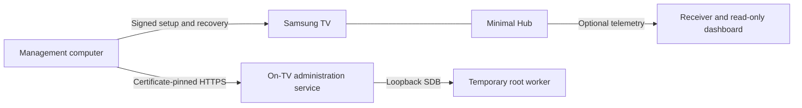

# Couchroot

**Your couch. Your TV. Your launcher.**

A minimal Samsung Tizen launcher, a read-only TV inspector, and an experimental
on-TV root agent. Built through hands-on work with a QN90A and an S90D.

[Get started](#try-the-launcher-on-your-computer) · [Choose a launcher](docs/guides/choosing-a-launcher.md) · [TV setup](docs/guides/tv-setup.md) ·
[Root agent](research/autonomous-root/README.md) · [Sources & credits](CREDITS.md) ·
[0BSD license](LICENSE)


*Actual launcher source running in the local browser workbench with simulated
apps. Screenshots contain no live device data.*

## What's here

- **Minimal Hub:** an offline, remote-first launcher with editable favorites,
  move/remove controls, compact layout, clock, settings and a Samsung Home fallback.
- **Native Hub (experimental, QN90A):** the same home screen drawn directly with the
  TV's EFL libraries from the earliest boot hook, reaching a rendered Hub in about
  **9–10 seconds** after a reboot instead of 37–47 seconds. See
  [choosing a launcher](docs/guides/choosing-a-launcher.md) and
  [QN90A boot performance](docs/devices/qn90a/boot-performance.md).
- **TV inspector:** read-only app, process and startup inspection alongside the
  telemetry dashboard. See [telemetry and inspection](docs/guides/telemetry.md).
- **Autonomous root agent:** a separate signed service that reacquires a temporary
  root context through TV-local SDB. It uses certificate-pinned HTTPS, authenticated
  loopback messages, bounded retries and a durable request journal.
- **Setup and recovery tools:** explicit device profiles, firmware/hash checks,
  signature verification, private configuration, backups and recovery journals.
- **Research:** documented experiments, including failures and model differences.

## A quieter home screen


Use the remote's arrows to choose, OK to open, and Back to return. Favorites are
editable from the TV. The Samsung Home shortcut remains available.


## Choose a launcher

Couchroot now has three launcher options. The signed web Hub remains the default
supported installation. Both native options are experimental and QN90A-only.

| | Signed web Hub (`web/`) | Pure-native Hub (`native-hub/`) | Native WebView Hub (`native/webview/`) |
| --- | --- | --- | --- |
| Rendering | Samsung's web-app runtime | C/Ecore/Evas, no web engine | Existing web UI in an EFL/EWK host |
| TVs | S90D and QN90A | QN90A firmware 2301.1 | QN90A firmware 2301.1 |
| Install | Signed app via `./tv-setup` | Private journaled boot hook + root agent | Private journaled boot hook + root agent |
| QN90A reboot milestone | ~37–47 s to observed foreground | ~9–10 s to native frame | ~16.3 s to first visible, rendered Hub (deferred presentation) |
| Preferences | Signed app storage | Separate native file | WebView storage; one-time native import |
| Features | Full platform integration | Core launcher UI | Shared web UI; native discovery/launch bridge, partial platform integration |
| Maturity | Supported source release | Experimental | Experimental |

These timings are different software milestones, not equivalent panel-latency
measurements. The WebView numbers are from background-mode boot; remote cold
restart loaded around 37.3 seconds in a later test while the signed Hub retired
the TV viewer. Deferred presentation now keeps the native window hidden until
its page has rendered, preserving the signed Hub during that handoff.
On S90D the signed Hub starts early through Samsung's own path;
neither native implementation has been ported or verified there.

The QN90A's normal web-app launch waits for firmware services. The pure-native
launcher avoids Chromium entirely. The WebView launcher instead starts the web
interface from the native boot path, using the TV's upgrade engine (Chromium 120
on the tested firmware), with Home routing and bounded crash supervision.
It does not provide all Tizen APIs just because it shares the interface.

Keep the signed web Hub installed with either native launcher: it holds the ISP
source role and remains a recovery path. See [choosing a launcher](docs/guides/choosing-a-launcher.md),
[WebView behavior and recovery](native/webview/README.md), and the
[QN90A boot measurements](docs/devices/qn90a/boot-performance.md).

## Try the launcher on your computer

No TV, signing certificate or root access is needed for the browser preview.
Requires Node.js 20+ and npm.

```sh
git clone https://github.com/splitcipher/couchroot.git
cd couchroot
npm ci
npm run dev
```

Open <http://127.0.0.1:8766>. Select a scenario, click the preview, then use arrow
keys, Enter and Escape. The workbench serves the same `web/` source as the TV
package, with simulated platform APIs. It does not contact a TV or NAS.

For screenshots and browser tests:

```sh
npx playwright install chromium
npm test
npm run screenshots
```

See [UI development](docs/guides/ui-development.md) for scenarios and remote-navigation
checks. Python 3 is also required to build an unsigned package with `npm run package`.

## Putting it on a TV

The [S89C record](docs/devices/s89c/README.md) covers inspection and a scoped
launcher/Home trial on firmware 2220.4. General setup and deployment commands still
refuse this model; cold-boot and standby validation remain pending.

Start with the [setup guide](docs/guides/tv-setup.md), [compatibility notes](docs/guides/device-compatibility.md)
and [recovery guidance](docs/guides/tv-setup.md#apply-interruption-and-recovery). If you already have an installation,
use the separate [UI deployment guide](docs/guides/ui-deployment.md).

You supply your own device addresses, Developer Mode setup, SDK tools and signing
credentials. Examples use reserved addresses. Site/trust files, keys, certificates,
signed packages and deployment journals stay outside Git. Native helpers use the
.NET SDK pinned in `global.json` and Python dependencies in `tvsetup/requirements.txt`.

**Experimental source release, not a universal installer or firmware jailbreak.**
Only exact reviewed profiles are intended for device operations. Samsung signing
privileges, SDK admission and startup behavior can vary by firmware. Root does
not bypass every SMACK, DRM or firmware restriction.

| Hardware | Recorded root-agent firmware | Observed behavior |
| --- | --- | --- |
| QN90A | `T-NKM2AKUC-2301.1` | Reboot startup, root acquisition, worker and registered-service recovery |
| S90D | `T-PTMDAKUC-0090-2130.0` | Reboot startup, root acquisition, worker and registered-service recovery |

These observations are not a promise for every size, region or firmware.
The [agent notes](research/autonomous-root/README.md) record exact tests and limits,
including remaining cold-power and recovery cases. Comprehensive installation
acceptance remains work in progress; see [release readiness](docs/project/release-readiness.md).

## How the pieces fit



The root agent is separate from the launcher and dashboard. A boot service
reacquires privileges; it does not permanently patch the firmware. If the service
cannot start while Developer Mode points to loopback, recovery can require the
remote: restore Host PC IP to your management computer and restart. Read the
[agent recovery instructions](research/autonomous-root/README.md) before enabling it.

## Repository map

| Path | Purpose |
| --- | --- |
| `web/` | Web Hub: the shipped launcher UI and platform adapters |
| `native-hub/` | Pure-native Hub (experimental, QN90A): C/EFL launcher, card styles, profiler |
| `native/webview/` | Native WebView Hub (experimental, QN90A): EWK host, native bridge, supervisor and recovery command renderer |
| `preview/` | Local browser workbench, fixtures and screenshot capture |
| `tv-setup`, `deploy-ui`, `tvsetup/` | Setup, signing integration, deployment and recovery |
| `tools/qn90a/`, `tools/s90d/` | One-shot, model-guarded device tools (Home routing, cleanup, casting, splash) |
| `tools/dotnet/` | .NET helpers those tools build and run on the TV |
| `scripts/` | Packaging, signing, reproducibility, dependency and privacy checks |
| `research/autonomous-root/` | Agent, client, payload sources and upstream provenance |
| `research/s90d-telemetry/` | Shared collector, inspector, receiver and dashboard |
| `research/` (other) | Experiment sources referenced by the device records |
| `docs/` | [Index](docs/README.md): guides, per-device records, research and project notes |
| `tests/` | Offline UI, native, protocol, setup and recovery tests |
| `examples/` | Public configuration templates |

Historical research scripts are not the supported setup entry point. The telemetry
folder's original model name is retained even though the integration serves both TVs.

## Security and contributions

Use only with devices you own or administer. Keep management endpoints on a trusted
network. Never post raw logs, device identifiers, keys or signing material in issues.
See [Security](SECURITY.md) and [Contributing](CONTRIBUTING.md).

This repo starts from a reviewed source snapshot rather than the development Git
history. See the [publication review](docs/project/publication-review.md) for what was checked
and the limits of those checks.

## License and thanks

Original Couchroot work is **[0BSD](LICENSE)**: use it with or without attribution.
Bundled third-party code retains its own licenses, including Vetro's MIT notices.
See [licensing details](LICENSE-STATUS.md).

Thanks especially to [Vetro](https://github.com/andrearicci93/vetro) and
[samsung-tv-root](https://github.com/chris-ritsen/samsung-tv-root) for the transport,
root payloads and research that helped make this possible. [Sources & Credits](CREDITS.md)
records included code, development references and tools.

Unofficial; not endorsed or supported by Samsung. Product names and marks belong
to their respective owners.
